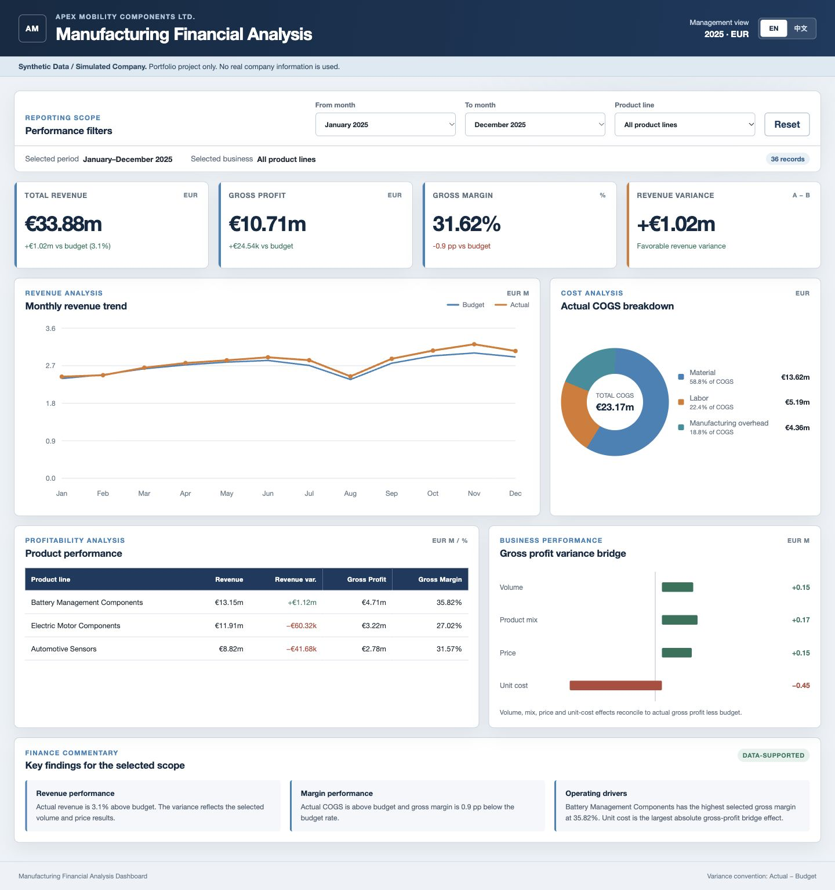

# Manufacturing Financial Analysis Dashboard

> **Synthetic Data / Simulated Company**  
> Portfolio project for manufacturing FP&A, Controlling, and financial data analysis. No real company information is used.



## Project overview

This portfolio project demonstrates an end-to-end manufacturing FP&A and Controlling workflow for a simulated automotive-components company. It converts monthly Budget-versus-Actual operating drivers into management-ready revenue, cost, profitability, and business-performance analysis.

The project is designed to demonstrate four practical capabilities:

- **Manufacturing FP&A:** monthly planning, performance tracking, product-line profitability, and management commentary.
- **Budget variance analysis:** consistent Actual-minus-Budget conventions, favorability interpretation, and percentage-point margin analysis.
- **Cost and margin controlling:** material, labor, manufacturing-overhead, COGS, Gross Profit, and volume/mix/price/unit-cost bridge analysis.
- **AI-assisted development with human verification:** AI supported implementation and test construction; the project owner defined the business requirements, controlled the financial logic, and verified the results.

The deliverable combines a traceable Python calculation pipeline, a formula-driven Excel model, automated financial controls, and a responsive bilingual static Dashboard suitable for GitHub Pages.

本项目为制造业 FP&A / Controlling 作品集，使用 2025 年模拟汽车零部件企业数据。所有数据均为合成数据，不代表任何真实企业。

## Project status

- [x] Phase 1 — data model, metric definitions, and calculation engine
- [x] Phase 2 — reproducible synthetic data and Python analysis
- [x] Phase 3 — interactive bilingual HTML Dashboard
- [x] Phase 4 — financial reconciliation and functional testing
- [x] Phase 5 — documentation, screenshots, and GitHub Pages guidance

## Business scope

The simulated company has three product lines:

- Electric Motor Components
- Battery Management Components
- Automotive Sensors

The dataset contains 36 controlled records at the grain of one month and one product line.

Dashboard modules include:

- Revenue analysis and monthly Budget-versus-Actual trend
- Material, labor, manufacturing-overhead, and total COGS analysis
- Gross profit, gross margin, and product-line profitability
- Revenue, cost, gross-profit, and gross-margin variance analysis
- Volume, product-mix, price, and unit-cost gross-profit bridge
- Data-supported finance commentary
- Month and product-line filters
- Complete English/Chinese interface switching with local language persistence

## Financial conventions

All amount, volume, and percentage variances begin with:

```text
Variance = Actual - Budget
```

- Positive Revenue and Gross Profit variances are normally favorable.
- Positive COGS variance is unfavorable.
- Gross Margin variance is expressed in percentage points.
- Full-year Budget and Actual Gross Margin are calculated from unrounded aggregated values (32.52% and 31.62% in the current synthetic dataset).
- Ratios are recalculated from aggregated amounts; row-level margins are never averaged.
- A zero or missing denominator returns `N/A`, not zero or infinity.
- Revenue equals Sales Volume × Unit Price.
- Gross Profit equals Revenue − COGS.
- COGS equals Material Cost + Labor Cost + Manufacturing Overhead.

See `docs/data_dictionary.md` and `docs/financial_methodology.md` for controlled definitions and analytical limitations.

## Technology

- Python
- Pandas
- NumPy
- Matplotlib
- openpyxl
- Node.js and `@oai/artifact-tool` for reproducible formula-driven Excel generation
- HTML, CSS, and vanilla JavaScript
- Python `unittest` and Node.js built-in test runner

No front-end framework or external browser dependency is required.

## Project structure

```text
.github/workflows/       optional GitHub Pages deployment workflow
dashboard/               static bilingual Dashboard and preview assets
data/                    synthetic CSV, JSON, and Excel deliverables
docs/                    data dictionary and financial methodology
reports/                 analytical outputs, charts, and test report
src/                     data generation, validation, metrics, and analysis
tests/                   Python and JavaScript automated tests
scripts/                 formula-driven Excel workbook builder
package.json             Dashboard test and optional workbook build commands
requirements-lock.txt    reproducible Python dependency versions
PROJECT_COMPLETION_REPORT.md
README.md
requirements.txt
```

## Run locally

Recommended environment: Python 3.12 and Node.js 20 or later. The Dashboard and its JavaScript tests use only browser APIs and Node.js built-ins, so there are no public npm runtime dependencies to install.

Create and activate a Python environment, then install the locked dependencies:

```bash
python -m venv .venv
source .venv/bin/activate
python -m pip install --upgrade pip
pip install -r requirements-lock.txt
```

On Windows PowerShell:

```powershell
python -m venv .venv
.venv\Scripts\Activate.ps1
python -m pip install --upgrade pip
pip install -r requirements-lock.txt
```

The broader dependency ranges in `requirements.txt` are intended for development upgrades; `requirements-lock.txt` is the reproducible portfolio baseline.

In a standard public environment, regenerate the controlled dataset, analytical outputs, Dashboard payload, and charts while retaining the reviewed Excel workbook included in `data/`:

```bash
python -m src.run_analysis --skip-workbook
```

The formula-driven Excel workbook was authored with the Codex-bundled `@oai/artifact-tool`, which is not published in the public npm Registry. Inside a compatible Codex workspace, `python -m src.run_analysis` performs the full rebuild including Excel. This limitation is documented explicitly so a public installation never depends on an unavailable package.

Serve the static Dashboard:

```bash
python -m http.server 8000 --directory dashboard
```

Open `http://127.0.0.1:8000/` and use the `EN / 中文` control to switch languages.

## Automated tests

Run the Python suite:

```bash
python -m unittest discover -s tests -v
```

Run the Dashboard calculation suite with Node.js:

```bash
node --test tests/test_dashboard_metrics.js
```

Current verified result:

- **30/30 Python tests passed**
- **12/12 JavaScript tests passed**
- **7/7 Excel Audit controls passed**
- Desktop and 390 px mobile browser checks passed
- No browser console errors or warnings

The tests cover formulas, aggregation, all single-month/product Dashboard selections, cost reconciliation, company and product-line gross-profit bridge reconciliation, bilingual label parity, exported CSV/JSON/XLSX consistency, formula presence, gross-margin precision, zero denominators, missing values, invalid drivers, and duplicate keys.

See `reports/test_results.md` for the complete control matrix.

Detailed local-to-GitHub commands and post-deployment checks are available in `docs/github_upload_guide.md`.

## Key deliverables

- `data/manufacturing_financial_data.csv` — Excel-compatible detailed dataset
- `data/manufacturing_financial_analysis.xlsx` — formula-driven workbook with Summary, Monthly Analysis, Product Analysis, GP Bridge, Data, and Audit sheets; blue Data cells are editable inputs and linked results recalculate in Excel
- `data/dashboard_data.json` — static Dashboard data payload
- `dashboard/index.html` — Dashboard entry page
- `dashboard/assets/dashboard-preview.png` — English preview
- `dashboard/assets/dashboard-preview-zh.png` — Chinese preview
- `reports/test_results.md` — financial and functional test evidence
- `PROJECT_COMPLETION_REPORT.md` — concise delivery summary

## GitHub Pages deployment

The repository includes an optional workflow at `.github/workflows/deploy-pages.yml`. It publishes only the static `dashboard/` directory.

The workflow verifies the required static files and runs the JavaScript Dashboard tests before uploading the Pages artifact. All HTML, CSS, JavaScript, image, and favicon paths are relative, so the Dashboard works under the repository subpath used by GitHub Pages.

After reviewing the project and pushing it to GitHub:

1. Open the repository’s **Settings → Pages**.
2. Set **Source** to **GitHub Actions**.
3. Run the **Deploy Dashboard to GitHub Pages** workflow, or push an approved change to `main`.
4. Open the deployment URL shown in the workflow summary.

For the target repository, the expected Pages URL is:

```text
https://565zybn2sn.github.io/manufacturing-financial-analysis/
```

This repository has not been uploaded or modified remotely by the delivery process.

## AI-assisted development statement

This is an AI-assisted simulated financial analysis project. The project owner defines the business requirements, financial logic, analytical scope, and performs result verification. AI assists with code implementation, documentation, and test construction. All outputs remain subject to the project owner’s review.

本项目为 AI 辅助开发的模拟财务分析项目。项目使用者负责业务需求、财务逻辑设计、分析范围与结果核验；AI 辅助代码实现、文档编写及测试构建。所有结果均需由项目使用者审核。

## Limitations

- The project does not represent or benchmark any real company.
- Operational causes such as supplier negotiations, downtime, customer loss, or procurement disruption cannot be proven unless event-level source data is provided.
- The model treats COGS as the cost of units sold and does not model inventory movements, work in progress, standard-cost absorption, or purchase-price variance.
- The Dashboard is static and browser-local; it does not include authentication, a database, or live ERP integration.
- Product mix is a company-portfolio effect. Product-line rows deliberately show no mix effect and reconcile using volume, price, and unit cost only.
